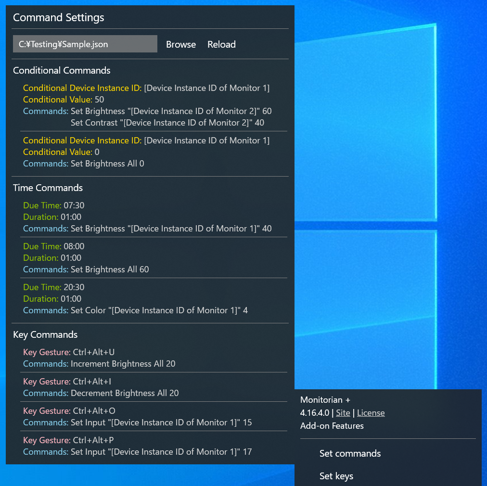

## Commands by Command-line Options

Commands are one of command-line options available as add-on features of Microsoft Store version.

- [Conditional Commands](#conditional-commands)
- [Time Commands](#time-commands)
- [Key Commands](#key-commands)

### Conditional Commands

A set of conditional commands is a sequence of commands to be executed when a specified condition is met. It consists of the following elements:

 - __Conditional Device Instance ID:__ Device Instance ID of a monitor whose brightness is regarded as the condition
 - __Conditional Value:__ Brightness (from 0 to 100) of a monitor which is regarded as the condition
 - __Commands:__ Commands to be executed when the condition is met

A command can:

 * Set __brightness__ or __contrast__ of a monitor or all monitors
 
A set of conditional commands is required for each conditional value of each conditional monitor. Therefore, if you want to execute commands for every brightness, you will need to define 101 sets of conditional commands.

The sets of conditional commands must be specified in an array of JSON format. Then the JSON file must be loaded using `/load` option. Please refer to [Load/Unload Commands](#loadunload-commands).

Here are a few remarks:

 - A set of conditional commands will be overwritten by another set of the same condition. To execute multiple commands by the same condition, they must be included in one set of conditional commands.
 - While conditional/time/key commands are being executed, other conditional/time/key commands will not be executed. Therefore, the brightness set by conditional commands will not trigger other conditional commands.
 - If the conditional monitor is in unison, the commands will not be executed.

#### JSON Sample

``` json
[
  {
    "ConditionalDeviceInstanceId": "[Device Instance ID of monitor 1]",
    "ConditionalValue": 50,
    "Commands": [
      {
        "Option": "SetBrightness",
        "DeviceInstanceId": "[Device Instance ID of monitor 2]",
        "IsAll": false,
        "Value": 100
      },
      {
        "Option": "SetContrast",
        "DeviceInstanceId": "[Device Instance ID of monitor 2]",
        "IsAll": false,
        "Value": 50
      }
    ]
  },
  {
    "ConditionalDeviceInstanceId": "[Device Instance ID of monitor 1]",
    "ConditionalValue": 0,
    "Commands": [
      {
        "Option": "SetBrightness",
        "DeviceInstanceId": null,
        "IsAll": true,
        "Value": 0
      }
    ]
  }
]
```

#### JSON Schema

``` json
{
  "$defs": {
    "Command": {
      "type": "object",
      "additionalProperties": false,
      "properties": {
        "Option": {
          "type": "string",
          "enum": [
            "SetBrightness",
            "SetContrast"
          ]
        },
       "DeviceInstanceId": {
          "type": [
            "string",
            "null"
          ]
        },
        "IsAll": {
          "type": "boolean"
        },
        "Value": {
          "type": "integer",
          "minimum": 0,
          "maximum": 100
        }
      },
      "required": [
        "Option",
        "Value"
      ]
    },
    "ConditionalCommand": {
      "type": "object",
      "additionalProperties": false,
      "properties": {
        "ConditionalDeviceInstanceId": {
          "type": "string"
        },
        "ConditionalValue": {
          "type": "integer",
          "minimum": 0,
          "maximum": 100
        },
        "Commands": {
          "type": "array",
          "items": {
            "$ref": "#/$defs/Command"
          }
        }
      },
      "required": [
        "ConditionalDeviceInstanceId",
        "ConditionalValue",
        "Commands"
      ]
    }
  },
  "type": "array",
  "items": {
    "$ref": "#/$defs/ConditionalCommand"
  }
}
```

[JSON Schema (combined)](commands-schema.json)

### Time Commands

A set of time commands is a sequence of commands to be executed when a specified daily due time comes. It consists of the following elements:

 - __Due Time Hours:__ Hours (from 0 to 23) of daily due time of commands
 - __Due Time Minutes:__ Minutes (from 0 to 59) of daily due time of commands
 - __Duration Minutes:__ Minutes (from 1 to 1439) of duration after due time while the commands will be executed
 - __Commands:__ Commands to be executed when the due time comes

A command can:

 * Set __brightness__ or __contrast__ of a monitor or all monitors
 * Set __color temperature preset__ of a monitor

The duration minutes is for the case where the system starts or resumes after a due time. For example, if the due time is __08:50__ and the duration is __30__ minutes, and the system is turned on at __09:00__, the commands that were supposed to be executed at __08:50__ will be executed. Conversely, if the system is turned on at __9:30__, the commands will not be executed. The longest duration is around 1 day (1439 minutes).

The sets of time commands must be specified in an array of JSON format. Then the JSON file must be loaded using `/load` option. Please refer to [Load/Unload Commands](#loadunload-commands).

Here are a few remarks:

 - A set of time commands will be overwritten by another set of the same due time. To execute multiple commands at the same due time, they must be included in one set of time commands.
 - While conditional/time/key commands are being executed, other conditional/time/key commands will not be executed. Therefore, the brightness set by time commands will not trigger conditional commands.

#### JSON Sample

``` json
[
  {
    "DueTimeHours": 9,
    "DueTimeMinutes": 0,
    "DurationMinutes": 60,
    "Commands": [
      {
        "Option": "SetBrightness",
        "DeviceInstanceId": "[Device Instance ID of monitor 1]",
        "IsAll": false,
        "Value": 40
      },
      {
        "Option": "SetBrightness",
        "DeviceInstanceId": "[Device Instance ID of monitor 2]",
        "IsAll": false,
        "Value": 45
      }
    ]
  },
  {
    "DueTimeHours": 10,
    "DueTimeMinutes": 0,
    "DurationMinutes": 60,
    "Commands": [
      {
        "Option": "SetBrightness",
        "DeviceInstanceId": null,
        "IsAll": true,
        "Value": 50
      }
    ]
  },
  {
    "DueTimeHours": 22,
    "DueTimeMinutes": 0,
    "DurationMinutes": 60,
    "Commands": [
      {
        "Option": "SetBrightness",
        "DeviceInstanceId": "[Device Instance ID of monitor 1]",
        "IsAll": false,
        "Value": 40
      },
      {
        "Option": "SetColor",
        "DeviceInstanceId": "[Device Instance ID of monitor 1]",
        "IsAll": false,
        "Value": 4
      }
    ]
  }
]
```

#### JSON Schema

``` json
{
  "$defs": {
    "Command": {
      "type": "object",
      "additionalProperties": false,
      "properties": {
        "Option": {
          "type": "string",
          "enum": [
            "SetBrightness",
            "SetContrast",
            "SetColor"
          ]
        },
        "DeviceInstanceId": {
          "type": [
            "string",
            "null"
          ]
        },
        "IsAll": {
          "type": "boolean"
        },
        "Value": {
          "type": "integer",
          "minimum": 0,
          "maximum": 100
        }
      },
      "required": [
        "Option",
        "Value"
      ]
    },
    "TimeCommand": {
      "type": "object",
      "additionalProperties": false,
      "properties": {
        "DueTimeHours": {
          "type": "integer",
          "minimum": 0,
          "maximum": 23
        },
        "DueTimeMinutes": {
          "type": "integer",
          "minimum": 0,
          "maximum": 59
        },
        "DurationMinutes": {
          "type": "integer",
          "minimum": 1,
          "maximum": 1439
        },
        "Commands": {
          "type": "array",
          "items": {
            "$ref": "#/$defs/Command"
          }
        }
      },
      "required": [
        "DueTimeHours",
        "DueTimeMinutes",
        "DurationMinutes",
        "Commands"
      ]
    }
  },
  "type": "array",
  "items": {
    "$ref": "#/$defs/TimeCommand"
  }
}
```

[JSON Schema (combined)](commands-schema.json)

### Key Commands

A set of key commands is a sequence of commands to be executed when a specified hot key is pressed. It consists of the following elements:

 - __Key Gesture:__ Key gesture (combination of modifier keys and a key delimited by '+') of hot key
 - __Description:__ Description of hot key
 - __Commands:__ Commands to be executed when the hot key is pressed

A command can:

 * Set __brightness__ or __contrast__ of a monitor or all monitors
 * Set __color temperature preset__ or __input source__ of a monitor
 * Increment or decrement __brightness__ of a monitor or all monitors

As for the available modifier keys (Alt, Ctrl, Shift, Windows) and keys, please refer the following pages.

- [ModifierKeys Enum](https://learn.microsoft.com/en-us/dotnet/api/system.windows.input.modifierkeys)
- [Key Enum](https://learn.microsoft.com/en-us/dotnet/api/system.windows.input.key)

If the specified hot key has been already used by the OS or other apps, the same hot key cannot be set. In addition, some combinations are not supported as hot keys.

The sets of key commands must be specified in an array of JSON format. Then the JSON file must be loaded using `/load` option. Please refer to [Load/Unload Commands](#loadunload-commands).

Here are a few remarks:

 - A set of key commands will be overwritten by another set of the same hot key. To execute multiple commands by the same hot key, they must be included in one set of key commands.
 - A key command to increment or decrement brightness will be repeatable only if all commands are those to increment or decrement brightness.
 - While conditional/time/key commands are being executed, other conditional/time/key commands will not be executed. Therefore, the brightness set by key commands will not trigger conditional commands.
 - Hot keys must be enabled in Key Settings.

#### JSON Sample

``` json
[
  {
    "KeyGesture": "Ctrl+Alt+O",
    "Description": "Monitor 1 to 60",
    "Commands": [
      {
        "Option": "SetBrightness",
        "DeviceInstanceId": "[Device Instance ID of monitor 1]",
        "IsAll": false,
        "Value": 60
      }
    ]
  },
  {
    "KeyGesture": "Ctrl+Alt+P",
    "Description": "All to 40",
    "Commands": [
      {
        "Option": "SetBrightness",
        "DeviceInstanceId": null,
        "IsAll": true,
        "Value": 40
      }
    ]
  },
  {
    "KeyGesture": "Ctrl+Alt+X",
    "Description": "Monitor 1 to 5000K",
    "Commands": [
      {
        "Option": "SetColor",
        "DeviceInstanceId": "[Device Instance ID of monitor 1]",
        "IsAll": false,
        "Value": 4
      }
    ]
  },
  {
    "KeyGesture": "Ctrl+Alt+Y",
    "Description": "Monitor 1 to HDMI 1",
    "Commands": [
      {
        "Option": "SetInput",
        "DeviceInstanceId": "[Device Instance ID of monitor 1]",
        "IsAll": false,
        "Value": 17
      }
    ]
  },
  {
    "KeyGesture": "Ctrl+Alt+I",
    "Description": "All increment",
    "Commands": [
      {
        "Option": "IncrementBrightness",
        "DeviceInstanceId": null,
        "IsAll": true,
        "Value": 25
      }
    ]
  },
  {
    "KeyGesture": "Ctrl+Alt+D",
    "Description": "All decrement",
    "Commands": [
      {
        "Option": "DecrementBrightness",
        "DeviceInstanceId": null,
        "IsAll": true,
        "Value": 25
      }
    ]
  }
]
```

#### JSON Schema

``` json
{
  "$defs": {
    "Command": {
      "type": "object",
      "additionalProperties": false,
      "properties": {
        "Option": {
          "type": "string",
          "enum": [
            "SetBrightness",
            "SetContrast",
            "SetColor",
            "SetInput",
            "IncrementBrightness",
            "DecrementBrightness"
          ]
        },
        "DeviceInstanceId": {
          "type": [
            "string",
            "null"
          ]
        },
        "IsAll": {
          "type": "boolean"
        },
        "Value": {
          "type": "integer",
          "minimum": 0,
          "maximum": 100
        }
      },
      "required": [
        "Option",
        "Value"
      ]
    },
    "KeyCommand": {
      "type": "object",
      "additionalProperties": false,
      "properties": {
        "KeyGesture": {
          "type": "string"
        },
        "Description": {
          "type": [
            "string",
            "null"
          ]
        },
        "Commands": {
          "type": "array",
          "items": {
            "$ref": "#/$defs/Command"
          }
        }
      },
      "required": [
        "KeyGesture",
        "Commands"
      ]
    }
  },
  "type": "array",
  "items": {
    "$ref": "#/$defs/KeyCommand"
  }
}
```

[JSON Schema (combined)](commands-schema.json)

### Load/Unload Commands

To enable conditional/time/key commands, create a command file, which is a JSON file containing all the commands in a single array. The command types (conditional, time, key) and their order do not matter.
Then load the JSON file using the `/load` option.

```
monitorian /load [file path of JSON file enclosed in quotes]
```
Loading new commands replaces all previously loaded commands.

After loading, you can browse the commands in Command Settings, accessible from menu window.

<br>
(Device Instance IDs are dummy)

To access Command Settings without loading a specific JSON file, use `/load` with `any` sub-option.

```
monitorian /load any
```

The rules for command file path are:

- The most recently specified path is used, whether it was specified with `/load` option or in Command Settings.
- The path specified in Command Settings is valid only until this app is closed.
- If `any` sub-option is used, the path of last loaded command file (if any) is used.

To disable all loaded commands, use `/unload` option.

```
monitorian /unload
```
